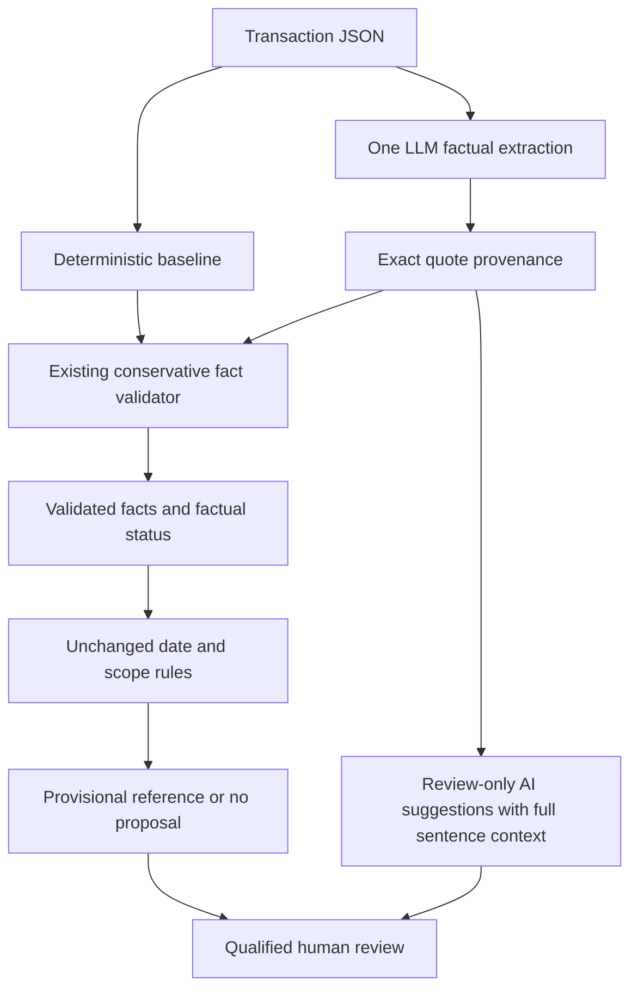
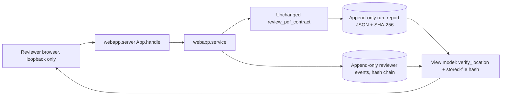

# Evidence architecture — post-submission Phase 3

The submitted version is `e075a9087b8f4dbebee3fe74f2cb427c5bc3a3c0`. Development takes place on `feature/full-product`; this document describes the additive review layer, not a new legal rule or tax-compliance product.

## Four separate questions

| Layer | Question | Implementation and authority |
| --- | --- | --- |
| Provenance | Does the exact quoted string occur in this contract? | `quote_positions()` records every exact character span. This proves origin only. |
| Interpretation | Does the text support the asserted personnel/control predicate? | Existing conservative lexical checks can support a predicate; unfamiliar exact-source AI claims become review-only suggestions. Neither exact matching nor a model assertion proves semantic truth. |
| Legal proposal | Do the validated facts, dates and declared scope permit a provisional reference? | Unchanged `report_rules()` consumes the validated factual status. Unverified suggestions never enter this interface. No new rates or statutory mappings. |
| Human review | What still requires judgment? | All legal treatment; also unfamiliar interpretation, missing facts, contradictions, rejected evidence and document precedence. No review approval workflow or automatic human-confirmed state is implemented. |



There is deliberately **no arrow from AI suggestions to the legal rules**. The direct-LLM baseline still returns only a factual category and is not eligible for a table proposal.

## What changed, and what did not

Previously, both `baseline_extract()` and `validate_evidence()` used `sentence_predicates()`. The hybrid could extract novel language but could not promote it beyond the same lexical vocabulary. Raw extraction and rejected quotes already existed in its report; they were not silently lost, but their different review meanings were not explicit.

Phase 3 adds `src/review_evidence.py`. Hybrid mode uses this wrapper; baseline mode keeps the original validator unchanged. The wrapper preserves original validation and provenance fields and adds `evidence_review`. It distinguishes an exact but unfamiliar interpretation from a fabricated quote or a quote blocked by a safety check. It supplies full surrounding sentences and positions for human inspection. This is **structured review routing, not a new semantic verification model**. It does not expand the automatic promotion vocabulary or demonstrate improved automatic factual recall.

The same five-field extraction schema and prompts are retained. Models cannot directly set review states, proposal eligibility or review approval. Dataset labels, case IDs and expected states are excluded from model inputs by the existing transaction adapter.

## Evidence states

| Case-level `evidence_review.state` | Meaning | Consequence |
| --- | --- | --- |
| `SUPPORTED_FACTUAL_EVIDENCE` | Required predicates passed the existing gate with no validation failures | The unchanged rules may propose a provisional item if date and scope checks also pass; human review remains mandatory. |
| `AI_SUGGESTED_REQUIRING_REVIEW` | At least one exact-source interpretation remains unverified and is not blocked by the added conservative vetoes | Show the claim and source as a lead. Do not promote it to validated facts or use it to justify a statutory proposal. |
| `CONTRADICTORY_EVIDENCE` | Opposing control evidence was recognized by the existing validator, including omitted evidence found in the contract | Abstain; require resolution of the conflict. |
| `INSUFFICIENT_EVIDENCE` | Missing control/supply, invalid or rejected evidence, or no usable lead | Abstain and explain missing information or validation failures. |

Each item carries `verbatim`, `positions`, `surrounding_context`, `interpretation_state`, `review_reasons` and `automatic_promotion_allowed`. The last field is a **per-item** gate, not permission for a case-level proposal: all validation, conflict, scope and date checks must still pass. Rejected items use `REJECTED_BY_SAFETY_GUARD`; they remain visible for audit but are not suggestions eligible for automatic promotion.

The wrapper vetoes fabricated quotes, assertion/quote mismatches, detected instructions, and recognized negated, conditional or inoperative surrounding text. It also quarantines unfamiliar assertions about known service-output terms. A veto blocks statutory proposals even if the older lexical validator would have accepted a clipped or heading-stripped assertion. A veto is conservative; it is not proof the model's interpretation is false.

Unfamiliar opposing claims may be retained with `unverified_contradiction=true`. They are not relabelled as a proven contradiction. Recognized contradictions take precedence over review-only suggestions. The legal-facing factual status remains distinct from the review state; a useful AI lead can coexist with `INSUFFICIENT_TO_ESTABLISH_CONTROL`.

## Evaluation and reproduction

The original 16-case and 12-case inputs and their manifests are unchanged. `tresata_challenge_v3.json` contains 12 new source-informed synthetic cases with eight exact gold anchors. `phase3_extraction_fixtures.json` separately contains deliberately chosen good and bad simulated extractions. These fixtures are **not LLM outputs**. One intentionally fabricated extracted quote tests provenance rejection; it is not a faulty gold anchor.

Both files and labels were frozen in `phase3_manifest.json` before running the old baseline or modifying the architecture. `results/phase3/before_*` contains the original outputs; `before_freeze.json` pins those outputs. Cases cover familiar and unfamiliar supervision, service outcomes, negation, obsolete text, clipping, fabrication, injection, missing facts and two kinds of contradiction. They were authored with knowledge of the source, so they are development data, not an independently validated holdout.

Run from the project root; use a fresh output directory each time:

```bash
python -m unittest discover -v
python demo.py
python evaluate_phase3.py --output-dir results/local/phase3-offline-new
python main.py --input tresata_adversarial_cases.json --mode baseline --output results/local/original-recheck.json
python main.py --input tresata_challenge_v2.json --mode baseline --output results/local/v2-recheck.json
```

The default Phase 3 command makes **zero network calls**, runs the baseline and explicitly simulated fixture replay, and records direct-LLM and hybrid live methods as `NOT_RUN`. Fixture API counts are zero; simulated client invocations are counted separately. It never overwrites an existing run directory.

An explicitly authorized live comparison uses one fixed model:

```bash
python evaluate_phase3.py --output-dir results/local/phase3-live-new --live-model cohere/north-mini-code:free
```

Only this opt-in reads a key from the environment or ignored `.env` file. The model flag overrides neither file nor environment configuration globally; it is passed explicitly to the comparison client. A catalogue check requires the exact `:free` ID and zero token/request pricing, and a key preflight checks an available spending limit. Neither guarantees provider capacity. Requests alternate direct/hybrid per case, use unchanged prompts, and wait 15 seconds after each completion. The runner stops both methods on the first API/schema failure, refusal or returned-model mismatch. No retry, automatic model switch, router alias or paid fallback is allowed. Exact returned IDs and raw synthetic outputs are retained in `requests.jsonl`, with configured-key redaction. All later cases are explicitly unexecuted. Check `completion.json` and the per-case statuses, not just the process exit code.

This live command creates a new experiment; it is not needed to reproduce the stored findings. Do not tune prompts or labels after reviewing outputs and describe the rerun as independent validation.

## How to interpret measurements

`evaluation` keeps existing metrics; `comparison` adds exact denominators and per-case expected/observed statuses, false-positive directional decisions, false-negative directional abstentions, quote errors, missing control and review-only cases. A false negative is not automatically an unsafe outcome: withholding a confident classification can be appropriate when validation is incomplete. An explicit opposite-direction prediction is counted as a false positive; unrecognized contradiction is reported separately through status agreement and the case table. Direct mode has no quote or predicate extraction, so these metrics are not applicable. Unexecuted cases never count as successful predictions.

Automatic agreement, exact quotation provenance and structured suggestion routing measure different properties. In particular, converting an existing raw quote into an explicit review-only item is not increased quote retrieval, improved legal accuracy or proof of an AI advantage.

## Remaining boundaries

The supported gate still uses narrow lexical patterns. Novel true facts may abstain; exact but irrelevant quotes may survive as uncertain suggestions when no known veto matches. Same-sentence negation can be overly broad. Context is sentence-based, not a full document or cross-reference model. Unmarked supersession and unknown contradictions can escape detection. Actual working practices are not verified. A fixed model ID does not pin provider infrastructure or weights over time. No new PDF ingestion, UI, reviewer approval storage, tax rules or production infrastructure is part of Phase 3.

## Phase 4: additive PDF input and page provenance

Phase 4 adds `src/pdf_ingestion.py`, `src/document_review.py` and `pdf_demo.py`. The original pipeline, legal rules, prompts and 87 tests are unchanged. The optional parser is imported lazily; JSON use remains dependency-free. The PDF CLI runs only the offline baseline. The adapter accepts an explicit extraction client for integration, but never loads environment credentials implicitly.

The flow is: bounded local file read → per-page extraction → extraction-order checks → whitespace mapping → existing evidence pipeline → PDF review gate. Invoice PDFs are extracted separately and never appended to contract text or used to infer legally relevant fields. Metadata remains manually supplied and subject to existing validation.

### Extraction and normalization

A document ID is `sha256:<file bytes hash>`. The report retains basename, hash, parser version, original page text and text hashes. `compile_text()` collapses whitespace only and records segments from normalized character positions back to original page strings. Synthetic spaces between pages have no fabricated page coordinates. A cross-page quotation has multiple original page fragments and requires visual review. Raw page strings preserve whitespace lost from the normalized analysis view.

Page numbers are one-based; character offsets are zero-based, end-exclusive Unicode string indices. These are not PDF byte, glyph, pixel or bounding-box coordinates. Each fragment contains an exact raw extracted quote, offsets, document identity and surrounding text with its own bounds. Repeated quotations retain every matching occurrence. Canonical `evidence_items` include origin paths into the raw `text_analysis` diagnostics.

`map_span()` recomputes the normalization map and verifies normalized and page text hashes. `verify_location()` checks identity, page, offset types/bounds, exact quote and context. Invalid or unencodable source strings, forged positions or altered mappings return failure; unresolved mapping blocks factual reliance. This verifies internal consistency against the extracted source. It is not a signed attestation: a future viewer must also hash the original PDF before displaying saved coordinates.

### Safety and review boundaries

Default limits are 5 MiB, 20 pages, 100,000 characters per page, 200,000 total characters and 2 MiB decoded content stream per page. Oversized text is flagged, not silently truncated. Parsing/decompression precedes some checks; these are not hard CPU or memory isolation. This local prototype is not a hostile-upload service.

Encrypted and malformed files are rejected. Blank/scanned pages require OCR or manual review; no OCR is attempted. Unreadable characters, page rotation, detected images or active actions, and plain-versus-layout extraction disagreement require document review. Parser diagnostics are sanitized. No document script, external command or network request is executed by ingestion. Comparing two modes of the same parser is not independent proof of reading order; hidden text, nested forms/images and complex layouts can escape detection.

The report's `review` is authoritative; `text_analysis` preserves diagnostic text-only findings. Incomplete/unreliable documents, unresolved mapping and cross-page evidence suppress supported factual conclusions (except a manually established out-of-scope residency). Exact PDF mapping never promotes `AI_SUGGESTED_EVIDENCE_REQUIRING_REVIEW`. Each evidence item retains both its text interpretation and document review status.

**All PDF statutory proposals are withheld**, even for clean selectable text, pending visual review of reading order, visibility and completeness. Phase 4 has no reviewer-confirmation workflow. Supported textual findings can still be shown with this limitation. The original JSON proposal behavior is unchanged. Legal treatment always requires qualified human review.

### Reproduction and measurement

```bash
python -m pip install -r requirements-pdf.txt
python -m unittest discover -v
python pdf_demo.py
python evaluate_pdfs.py --output-dir results/local/pdf-evaluation-new
```

The frozen `tests/fixtures/pdf_v1/manifest.json` records expectations and hashes for 18 synthetic PDFs and one unsupported text file. The fixtures were authored from the intended failure modes and frozen before extraction evaluation. They are development tests, not independently validated model cases. Evaluation counts canonical evidence items separately from page fragments (one cross-page item has two fragments). The invoice fixture also runs as a contract-input stress case; separate invoice integration is tested and demonstrated. See [PHASE_4_REPORT.md](PHASE_4_REPORT.md) for exact outcomes and [THIRD_PARTY_NOTICES.md](THIRD_PARTY_NOTICES.md) for dependency licensing.

## Phase 5: local review workspace

Phase 5 adds the `webapp/` package, `review_app.py` and `tests/test_webapp.py`. It does not modify `src/` or any earlier test, fixture or result. It is a presentation and record-keeping layer around `review_pdf_contract()`:



There is **no arrow from reviewer events back to the pipeline or rules**. A run is analysed once and stored with its hash. Reviewer events sit beside the run and carry an explicit `effect` of no change to findings, proposals or tax treatment. Correcting transaction details creates a new run from the same stored documents; earlier runs and their decisions remain readable.

Spans are displayed only when the stored file still matches the analysed SHA-256 and `verify_location()` accepts the fragment. Highlights address extracted text, not PDF glyph or pixel positions; the original PDF is shown unannotated in the browser's own viewer. The optional "supplied extraction replay" passes a caller-provided five-field extraction through the existing hybrid validator without any network client. It is recorded as simulated, with zero model network calls. All PDF statutory proposals remain withheld, exactly as in Phase 4. See [PHASE_5_REPORT.md](PHASE_5_REPORT.md).


## Phase 6: integrity fail-closed, rule versioning and resource limits

- **Fail-closed integrity.** `ReviewService.assess()` checks the run row hash, the hash recorded by its chained `ANALYSIS_RUN` event, the full run context (transaction metadata, document identities, method and run identity), stored JSON validity, history payload validity, chain links, and the case row against `CASE_CREATED`. Stored PDFs are checked separately.
  - **Any check fails:** case view, case list and export withhold findings, evidence and page text, and return diagnostics. Exports place such runs under `forensic_untrusted`.
  - **Only a stored PDF fails:** the trusted analysis remains visible, but PDF-dependent decisions are refused.

  The history is unsigned local SQLite: tamper-evident, not tamper-proof.
- **Versioned Act selection.** `src/act_selection_v1.json` replaces the hard-coded boundary. `load_act_selection()` validates it at import and requires agreement with the cited `act_transition` rule. Results carry `rule_version`, and the file is part of implementation hashes. Legal behaviour is unchanged: historical baselines are identical apart from the added field.
- **Resource limits.** PDF parsing runs under temporary, context-local pypdf decompression limits (8 MiB per stream). Analyses are limited to one at a time, uploads are subject to a storage quota, and request bodies use strict JSON (no duplicate keys or NaN). A decision is re-checked against the latest run inside its write transaction.


### Independent Phase 6 audit hardening

New case/run/history writes commit in a single SQLite transaction after analysis. Upload quota and duplicate checks also run under `BEGIN IMMEDIATE`. Internal document paths use POSIX no-follow directory descriptors and unpredictable exclusive temporary files. Downloads serve the same bounded bytes that were hash-verified. These web-storage operations currently require POSIX support; the JSON/PDF CLI paths are unchanged.

Older local runs lack the context anchor and are preserved as untrusted forensic records; no automatic backfill certifies potentially modified metadata. Recreate a case from original documents and checked manual fields. Full recomputation of an unsigned chain and tail truncation still require external anchoring to detect.

The independent stress probe exceeded its **external audit CPU limit** with a 43 KB PDF despite the application's stream caps. The app has no process-level CPU/memory deadline. Arbitrary untrusted PDF ingestion is BLOCKED pending isolated parsing; known synthetic local demonstrations remain usable. The audit harness is not a runtime sandbox. See [PHASE_6_CODEX_AUDIT.md](PHASE_6_CODEX_AUDIT.md) for actual results, failure evidence and scope.


## Phase 6C: resource-isolated document review

`src/pdf_worker.py` wraps the existing `src/pdf_ingestion.py` parser. The document-review adapter now calls `read_pdf_isolated()`, so the web app, PDF demo and PDF evaluator use workers. The low-level `read_pdf()` remains available for trusted parser diagnostics and unit tests; it is not a safe untrusted-input entry point. There is no automatic in-process fallback on unsupported platforms or startup failure.

The parent reads at most 5 MiB from a regular file and snapshots the bytes into a private temporary directory. A fresh spawned Python process installs Linux `RLIMIT_AS` (256 MiB), `RLIMIT_CPU` (4/5 s), `RLIMIT_FSIZE` (16 MiB), disables core dumps, clears inherited environment variables and redirects parser diagnostics before parsing. The parent enforces an 8-second wall deadline, kills the worker/session if necessary and reaps it. Output is bounded JSON read only after exit zero; partial output or any failed child is discarded. The parent validates file identity, document/page schema, text hashes and the normalization map. These checks prove internal consistency, not an independently attested parser interpretation.

Failures distinguish wall timeout, CPU/memory/output exhaustion, parser exception, crash, invalid result and unsupported platform. Every such document has empty pages/text/spans and mandatory review. The adapter's original factual and legal gates remain unchanged. Normal frozen fixture outcomes and exact source positions are preserved.

The prior audit's resource blocker is now reproduced through this runtime path and contained. This is **not** a complete security sandbox: the worker retains its OS account's filesystem/network permissions. No provider/model calls, OCR or document script execution are added. See `PHASE_6C_REPORT.md` for measured evidence and `docs/MULTI_PHASE_GOAL.md` for remaining authorized phases.
