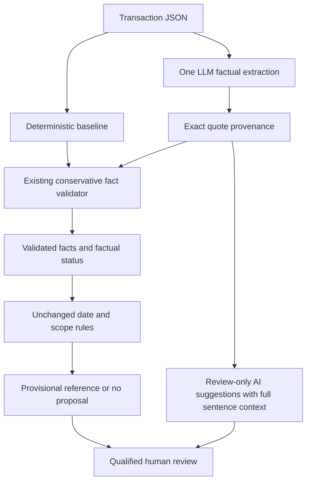

# Evidence architecture — post-submission Phase 3

The submitted version is `e075a9087b8f4dbebee3fe74f2cb427c5bc3a3c0`. Development takes place on `feature/full-product`; this document describes the additive review layer, not a new legal rule or tax-compliance product.

## Four separate questions

| Layer | Question | Implementation and authority |
| --- | --- | --- |
| Provenance | Does the exact quoted string occur in this contract? | `quote_positions()` records every exact character span. This proves origin only. |
| Interpretation | Does the text support the asserted personnel/control predicate? | Existing conservative lexical checks can support a predicate; unfamiliar exact-source AI claims become review-only suggestions. Neither exact matching nor a model assertion proves semantic truth. |
| Legal proposal | Do the validated facts, dates and declared scope permit a provisional reference? | Unchanged `report_rules()` consumes the validated factual status. Unverified suggestions never enter this interface. No new rates or statutory mappings. |
| Human review | What still requires judgment? | All legal treatment; also unfamiliar interpretation, missing facts, contradictions, rejected evidence and document precedence. No review approval workflow or automatic human-confirmed state is implemented. |



There is deliberately **no arrow from AI suggestions to the legal rules**. The direct-LLM baseline still returns only a factual category and is not eligible for a table proposal.

## What changed, and what did not

Previously, both `baseline_extract()` and `validate_evidence()` used `sentence_predicates()`. The hybrid could extract novel language but could not promote it beyond the same lexical vocabulary. Raw extraction and rejected quotes already existed in its report; they were not silently lost, but their different review meanings were not explicit.

Phase 3 adds `src/review_evidence.py`. Hybrid mode uses this wrapper; baseline mode keeps the original validator unchanged. The wrapper preserves original validation and provenance fields and adds `evidence_review`. It distinguishes an exact but unfamiliar interpretation from a fabricated quote or a quote blocked by a safety check. It supplies full surrounding sentences and positions for human inspection. This is **structured review routing, not a new semantic verification model**. It does not expand the automatic promotion vocabulary or demonstrate improved automatic factual recall.

The same five-field extraction schema and prompts are retained. Models cannot directly set review states, proposal eligibility or review approval. Dataset labels, case IDs and expected states are excluded from model inputs by the existing transaction adapter.

## Evidence states

| Case-level `evidence_review.state` | Meaning | Consequence |
| --- | --- | --- |
| `SUPPORTED_FACTUAL_EVIDENCE` | Required predicates passed the existing gate with no validation failures | The unchanged rules may propose a provisional item if date and scope checks also pass; human review remains mandatory. |
| `AI_SUGGESTED_REQUIRING_REVIEW` | At least one exact-source interpretation remains unverified and is not blocked by the added conservative vetoes | Show the claim and source as a lead. Do not promote it to validated facts or use it to justify a statutory proposal. |
| `CONTRADICTORY_EVIDENCE` | Opposing control evidence was recognized by the existing validator, including omitted evidence found in the contract | Abstain; require resolution of the conflict. |
| `INSUFFICIENT_EVIDENCE` | Missing control/supply, invalid or rejected evidence, or no usable lead | Abstain and explain missing information or validation failures. |

Each item carries `verbatim`, `positions`, `surrounding_context`, `interpretation_state`, `review_reasons` and `automatic_promotion_allowed`. The last field is a **per-item** gate, not permission for a case-level proposal: all validation, conflict, scope and date checks must still pass. Rejected items use `REJECTED_BY_SAFETY_GUARD`; they remain visible for audit but are not suggestions eligible for automatic promotion.

The wrapper vetoes fabricated quotes, assertion/quote mismatches, detected instructions, and recognized negated, conditional or inoperative surrounding text. It also quarantines unfamiliar assertions about known service-output terms. A veto blocks statutory proposals even if the older lexical validator would have accepted a clipped or heading-stripped assertion. A veto is conservative; it is not proof the model's interpretation is false.

Unfamiliar opposing claims may be retained with `unverified_contradiction=true`. They are not relabelled as a proven contradiction. Recognized contradictions take precedence over review-only suggestions. The legal-facing factual status remains distinct from the review state; a useful AI lead can coexist with `INSUFFICIENT_TO_ESTABLISH_CONTROL`.

## Evaluation and reproduction

The original 16-case and 12-case inputs and their manifests are unchanged. `tresata_challenge_v3.json` contains 12 new source-informed synthetic cases with eight exact gold anchors. `phase3_extraction_fixtures.json` separately contains deliberately chosen good and bad simulated extractions. These fixtures are **not LLM outputs**. One intentionally fabricated extracted quote tests provenance rejection; it is not a faulty gold anchor.

Both files and labels were frozen in `phase3_manifest.json` before running the old baseline or modifying the architecture. `results/phase3/before_*` contains the original outputs; `before_freeze.json` pins those outputs. Cases cover familiar and unfamiliar supervision, service outcomes, negation, obsolete text, clipping, fabrication, injection, missing facts and two kinds of contradiction. They were authored with knowledge of the source, so they are development data, not an independently validated holdout.

Run from the project root; use a fresh output directory each time:

```bash
python -m unittest discover -v
python demo.py
python evaluate_phase3.py --output-dir results/local/phase3-offline-new
python main.py --input tresata_adversarial_cases.json --mode baseline --output results/local/original-recheck.json
python main.py --input tresata_challenge_v2.json --mode baseline --output results/local/v2-recheck.json
```

The default Phase 3 command makes **zero network calls**, runs the baseline and explicitly simulated fixture replay, and records direct-LLM and hybrid live methods as `NOT_RUN`. Fixture API counts are zero; simulated client invocations are counted separately. It never overwrites an existing run directory.

An explicitly authorized live comparison uses one fixed model:

```bash
python evaluate_phase3.py --output-dir results/local/phase3-live-new --live-model cohere/north-mini-code:free
```

Only this opt-in reads a key from the environment or ignored `.env` file. The model flag overrides neither file nor environment configuration globally; it is passed explicitly to the comparison client. A catalogue check requires the exact `:free` ID and zero token/request pricing, and a key preflight checks an available spending limit. Neither guarantees provider capacity. Requests alternate direct/hybrid per case, use unchanged prompts, and wait 15 seconds after each completion. The runner stops both methods on the first API/schema failure, refusal or returned-model mismatch. No retry, automatic model switch, router alias or paid fallback is allowed. Exact returned IDs and raw synthetic outputs are retained in `requests.jsonl`, with configured-key redaction. All later cases are explicitly unexecuted. Check `completion.json` and the per-case statuses, not just the process exit code.

This live command creates a new experiment; it is not needed to reproduce the stored findings. Do not tune prompts or labels after reviewing outputs and describe the rerun as independent validation.

## How to interpret measurements

`evaluation` keeps existing metrics; `comparison` adds exact denominators and per-case expected/observed statuses, false-positive directional decisions, false-negative directional abstentions, quote errors, missing control and review-only cases. A false negative is not automatically an unsafe outcome: withholding a confident classification can be appropriate when validation is incomplete. An explicit opposite-direction prediction is counted as a false positive; unrecognized contradiction is reported separately through status agreement and the case table. Direct mode has no quote or predicate extraction, so these metrics are not applicable. Unexecuted cases never count as successful predictions.

Automatic agreement, exact quotation provenance and structured suggestion routing measure different properties. In particular, converting an existing raw quote into an explicit review-only item is not increased quote retrieval, improved legal accuracy or proof of an AI advantage.

## Remaining boundaries

The supported gate still uses narrow lexical patterns. Novel true facts may abstain; exact but irrelevant quotes may survive as uncertain suggestions when no known veto matches. Same-sentence negation can be overly broad. Context is sentence-based, not a full document or cross-reference model. Unmarked supersession and unknown contradictions can escape detection. Actual working practices are not verified. A fixed model ID does not pin provider infrastructure or weights over time. No new PDF ingestion, UI, reviewer approval storage, tax rules or production infrastructure is part of Phase 3.
